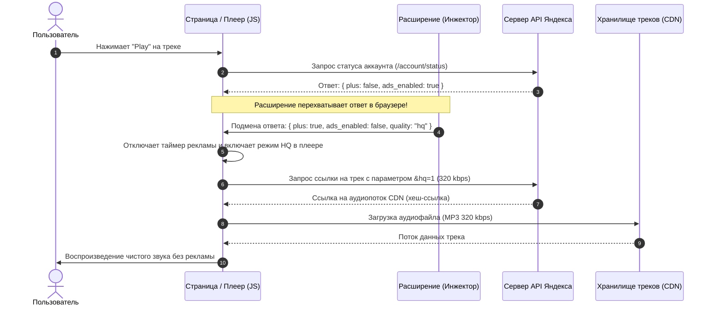

# YandexMusicExtension

В веб-версии плеер состоит из двух частей: **интерфейс в браузере (клиент)** и **файловое хранилище (CDN-сервер)**. Расширение встаёт между ними прямо в оперативной памяти браузера.



---

## Возможности расширения

* **Высокое качество звука (HQ 320 kbps):** автоматическая разблокировка и передача флага `quality: "hq"` в плеер для загрузки чистого аудиопотока 320 kbps с официального CDN.
* **Блокировка аудиорекламы:** нейтрализация таймеров рекламных вставок между треками.
* **Снятие лимита на переключение:** свободный пропуск треков без всплывающих окон с предложением оформить подписку.
* **Удаление навязчивых баннеров:** очистка интерфейса веб-плеера от блокирующих промо-плашек.
* **Непрерывное воспроизведение:** предотвращение автоматической паузы («Вы ещё слушаете?»).

---

## Установка расширения

Расширение работает в любых Chromium-браузерах (**Brave**, **Google Chrome**, **Яндекс Браузер**, **Microsoft Edge**, **Opera**).

1. Склонируйте или скачайте этот репозиторий в отдельную папку:
   ```bash
   git clone https://github.com/brsssddaa/YandexMusicExtension.git
   ```
2. Откройте страницу расширений в вашем браузере:
   * **Brave:** `brave://extensions`
   * **Chrome:** `chrome://extensions`
   * **Edge:** `edge://extensions`
   * **Яндекс Браузер:** `browser://tune`
3. В правом верхнем углу включите тумблер **«Режим разработчика»** (Developer mode).
4. Нажмите кнопку **«Загрузить распакованное расширение»** (Load unpacked) в левом верхнем углу.
5. Выберите папку с распакованным расширением.
6. Откройте [music.yandex.ru](https://music.yandex.ru/) и наслаждайтесь любимыми треками без ограничений!

---

Расширение было полностью сделано с помощью вайбкода.
