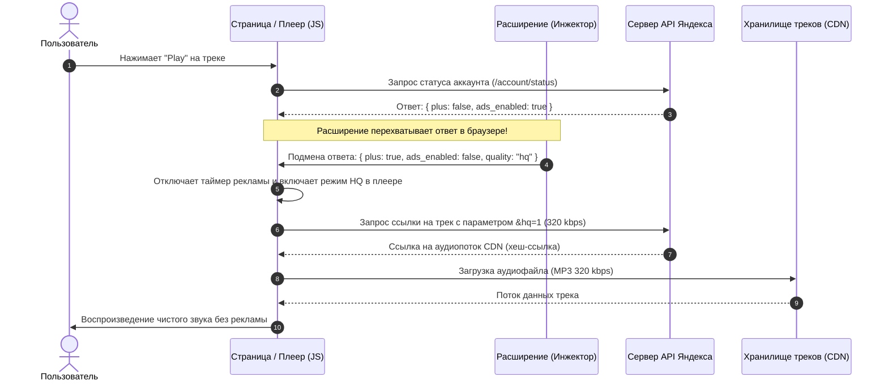

# YandexMusicExtension

В веб-версии плеер состоит из двух частей: **интерфейс в браузере (клиент)** и **файловое хранилище (CDN-сервер)**. Расширение встаёт между ними прямо в оперативной памяти браузера.



---

## Возможности расширения

* **Высокое качество звука (HQ 320 kbps):** автоматическая разблокировка и передача флага `quality: "hq"` в плеер для загрузки чистого аудиопотока 320 kbps с официального CDN.
* **Блокировка аудиорекламы:** нейтрализация таймеров рекламных вставок между треками.
* **Снятие лимита на переключение:** свободный пропуск треков без всплывающих окон с предложением оформить подписку.
* **Удаление навязчивых баннеров:** очистка интерфейса веб-плеера от блокирующих промо-плашек.
* **Непрерывное воспроизведение:** предотвращение автоматической паузы («Вы ещё слушаете?»).
* **Мобильная адаптация:** автоматическая оптимизация интерфейса веб-плеера под экраны смартфонов.

---

## Установка расширения

### Для ПК

Поддерживаются любые Chromium-браузеры (**Google Chrome**, **Brave**, **Яндекс Браузер**, **Microsoft Edge**, **Opera**).

1. Скачайте архив репозитория (кнопка **Code** ➔ **Download ZIP**) или склонируйте его:
   ```bash
   git clone https://github.com/brsssddaa/YandexMusicExtension.git
   ```
2. Если скачали `.zip`, распакуйте архив в удобную папку.
3. Откройте страницу управления расширениями в браузере:
   * **Chrome:** `chrome://extensions`
   * **Brave:** `brave://extensions`
   * **Edge:** `edge://extensions`
   * **Яндекс Браузер:** `browser://tune`
4. В правом верхнем углу включите тумблер **«Режим разработчика»** (Developer mode).
5. Нажмите кнопку **«Загрузить распакованное расширение»** (Load unpacked) в левом верхнем углу.
6. Выберите папку с распакованным расширением.
7. Откройте [music.yandex.ru](https://music.yandex.ru/) и наслаждайтесь любимой музыкой!

---

### Для телефона

> **Важно:** Стандартный мобильный Google Chrome на Android не поддерживает установку расширений.  
> Для работы на телефоне скачайте **Kiwi Browser** или **Firefox**, так как в них можно ставить расширения!

* **Kiwi Browser (Рекомендуется):**
  * [Официальный GitHub (скачать APK)](https://github.com/kiwibrowser/src.chromium/releases)
  * [Страница на 4PDA](https://4pda.to/forum/index.php?showtopic=928090)
* **Firefox для Android:**
  * [Google Play](https://play.google.com/store/apps/details?id=org.mozilla.firefox)
  * [Официальный сайт Mozilla](https://www.mozilla.org/ru/firefox/browsers/mobile/android/)

#### Инструкция по установке на телефон (на примере Kiwi Browser):
1. Скачайте архив репозитория на телефон (кнопка **Code** ➔ **Download ZIP** вверху этой страницы).
2. Откройте **Kiwi Browser**.
3. Нажмите на три точки в верхнем правом углу и выберите пункт **«Расширения»** (или введите в адресную строку `chrome://extensions`).
4. Включите переключатель **«Режим разработчика»** (Developer mode).
5. Нажмите кнопку **«+ (from .zip/.crx/.user.js)»**.
6. В открывшемся проводнике перейдите в папку **«Загрузки»** (Download) и выберите скачанный архив `YandexMusicExtension-main.zip`.
7. Откройте [music.yandex.ru](https://music.yandex.ru/) — мобильная версия сама переключится в полнофункциональный плеер без рекламы и с высоким качеством треков!

---

💬 **[Обсуждение и чат пользователей](https://github.com/brsssddaa/YandexMusicExtension/discussions)**

---

Расширение было полностью сделано с помощью вайбкода.
